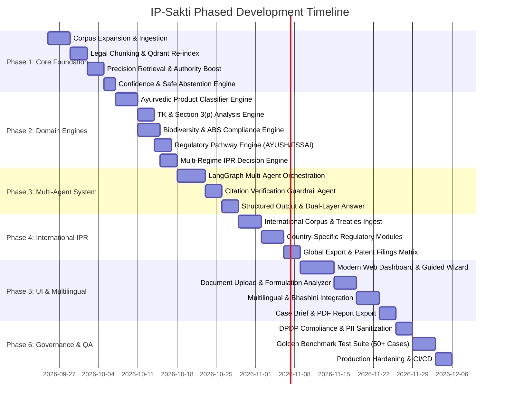
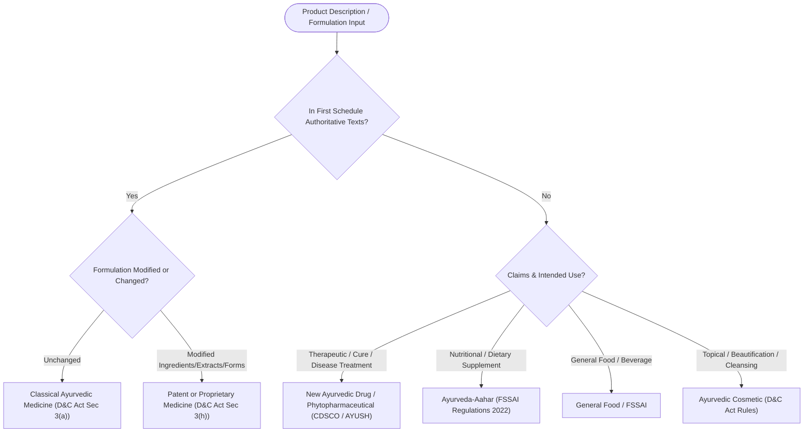
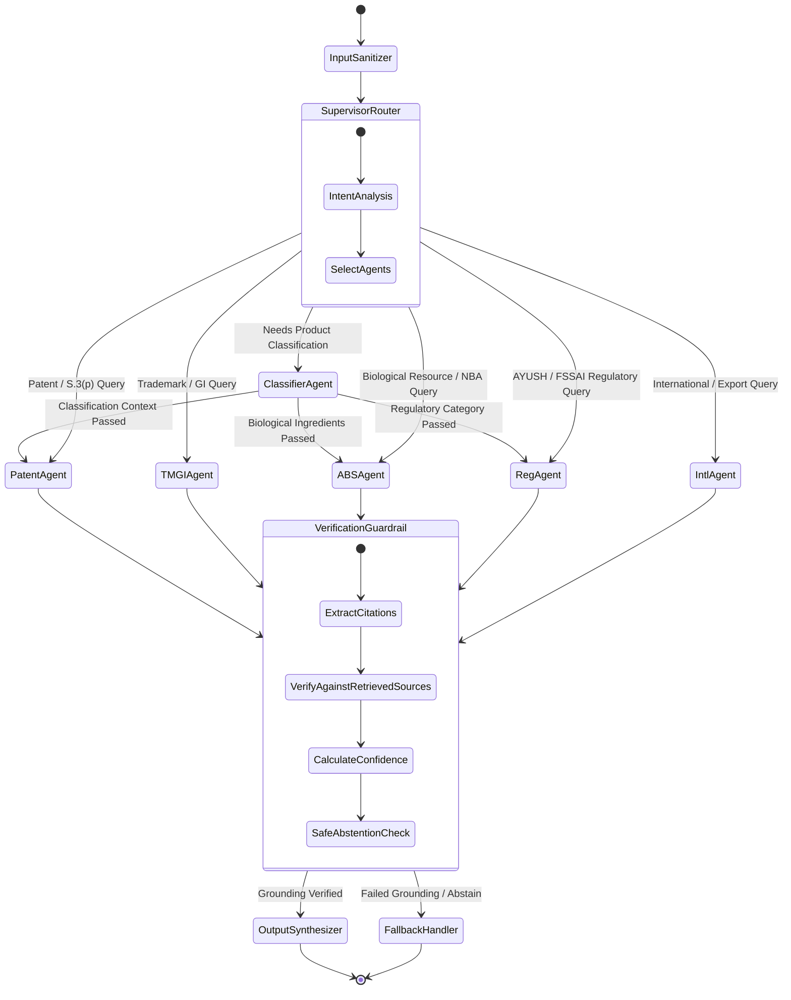
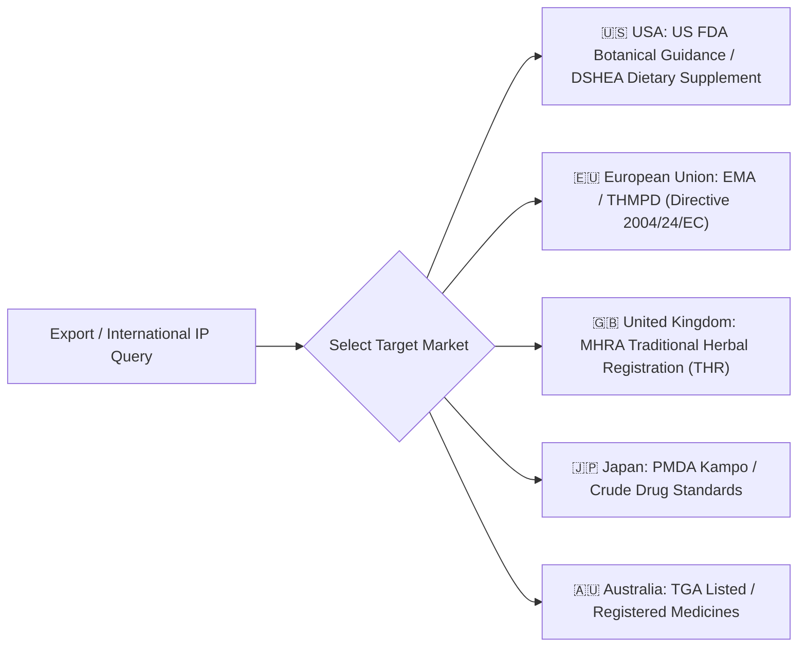

# IP-Sakti: Comprehensive & Phased Implementation Plan
## Ayurveda, Traditional Knowledge & Intellectual Property Rights AI Platform

---

## Executive Summary

**IP-Sakti** is an advanced, retrieval-grounded AI legal intelligence platform designed specifically for the intersection of **Ayurveda, Traditional Knowledge (TK), Indian Intellectual Property Law (Patents, Trademarks, Geographical Indications, Copyrights, Designs, Trade Secrets, PPV&FR), Biological Diversity (ABS Compliance), and Regulatory Frameworks (AYUSH, CDSCO, FSSAI)**, extending to **International IPR & Global Market Access (WIPO, US FDA, EU THMPD, PCT, Madrid System)**.

This implementation plan translates the entire specification from [`left_to_do.md`](file:///Users/aspa/Desktop/abhishek/IP_Sakti/left_to_do.md) and [`prompt.md`](file:///Users/aspa/Desktop/abhishek/IP_Sakti/prompt.md) into a structured, production-grade, 6-phase engineering blueprint.

---

## 1. Gap Analysis: Current Baseline vs. Target State

| Capability Area | Current Repository State | Target System Requirements (`left_to_do.md`) | Gap Status |
| :--- | :--- | :--- | :--- |
| **1. Legal Corpus Coverage** | 7 raw PDFs (Patents Act 1970, Patent Rules 2003, Pharma Guidelines 2014, TK Guidelines 2012, Manual 2019, TKDL factsheet, Overview of Ayurveda) | 25+ comprehensive statutory documents including Patents Rules 2024, AYUSH Examination Guidelines 2025, Biological Diversity Act 2002/2023, Drugs & Cosmetics Act, FSSAI Ayurveda-Aahar 2022, WIPO GRATK Treaty 2024, US FDA Botanical Guidelines, EU THMPD. | 🔴 Major Gap |
| **2. Jurisdiction Handling** | Single implicit jurisdiction (India). | Dynamic toggle for 🇮🇳 **India** vs. 🌍 **International** (with US, EU, UK, Japan, Australia country scoping), strict legal separation, law version/date tagging. | 🔴 Major Gap |
| **3. Ayurvedic Classification** | None. | Guided interactive questionnaire (Classical, Proprietary, Generic, Phytopharmaceutical, Ayurveda-Aahar, Food, Cosmetic) mapping to regulators and IP paths. | 🔴 Major Gap |
| **4. Multi-Regime IPR Routing** | Basic patent statute search. | Comprehensive decision router for Patents (Sec 3(p), 3(d), 3(e)), GIs, Trademarks (Classes 5/3/30), Copyrights, Designs, Trade Secrets, PPV&FR. | 🔴 Major Gap |
| **5. Traditional Knowledge & TKDL** | Static TK guidelines PDF chunks. | Active TK detection, Section 3(p) prior art analyzer, TKDL citation pointers, innovation vs. classical formulation separation. | 🟡 Partial |
| **6. Biodiversity & ABS Compliance** | None. | Form I/II/III recommendation, NBA/SBB jurisdiction mapping, Section 6/19/20 compliance checklist, Commercial vs Research benefit-sharing tracker. | 🔴 Major Gap |
| **7. Product Regulatory Module** | None. | Drugs & Cosmetics Act (First Schedule), AYUSH GMP, FSSAI Ayurveda-Aahar, DMR(OA) Act advertising checks, Phytopharmaceutical GSR 918(E). | 🔴 Major Gap |
| **8. International IP Module** | None. | WIPO GRATK Treaty 2024, Nagoya Protocol, PCT, Madrid System, US FDA Botanical Drug Guidance, EU THMPD herbal directive. | 🔴 Major Gap |
| **9. Retrieval & Reranking** | Dense (BGE-M3) + BM25 + RRF + BAAI Cross-Encoder reranker. | Query legal-reference parsing, authority-weighted scoring (Statute > Rules > Guidelines > Manuals), metadata filtering by jurisdiction/regime. | 🟡 Solid Base, Needs Tuning |
| **10. Knowledge Graph** | None. | Relational multi-hop graph connecting: Product ➔ Ingredients ➔ Biological Resource ➔ TK ➔ Regulation ➔ IP Type ➔ Authority ➔ Jurisdiction. | 🔴 Major Gap |
| **11. Agentic Orchestration** | Single linear pipeline (`rag_pipeline.py`). | LangGraph multi-agent hierarchy: Classifier Agent, Patent Agent, TM/GI Agent, ABS Agent, Regulatory Agent, International Agent, Citation Guardrail Agent. | 🔴 Major Gap |
| **12. Citation & Verification** | Context metadata in prompt. | Strict citation verification, pinpoint Section/Rule/Page mapping, anti-phantom citation filter ("No citation = No legal claim"). | 🟡 Partial |
| **13. Confidence & Abstention** | Basic fallback message if 0 chunks. | Multi-factor confidence scoring (High/Medium/Low) based on source freshness, similarity, and coverage; strict safe abstention when sources are inadequate. | 🔴 Major Gap |
| **14. Human Escalation** | Simple Markdown conversation dump. | Formal "Escalate to IP Facilitator" module with auto-generated Case Summary Brief (risks, missing info, questions for attorney, exportable PDF/JSON). | 🔴 Major Gap |
| **15. Multilingual Support** | English only. | Multilingual interaction (Hindi, Marathi, Tamil, Telugu, Bengali, Gujarati, etc.) with legal terminology preservation and translation integrity. | 🔴 Major Gap |
| **16. User Interface & Experience** | Simple 3-column static layout. | Guided step-by-step wizard, Glassmorphic modern aesthetic, Dark/Light modes, interactive checklist, PDF document upload/analysis, voice input. | 🟡 Basic MVP, Needs Overhaul |
| **17. Governance, DPDP & Audit** | Basic console prints. | DPDP Act compliance, PII redaction, audit logs of queries/citations/confidence, golden benchmark evaluation suite. | 🔴 Major Gap |

---

## 2. Target System Architecture

```mermaid
flowchart TB
    subgraph UI ["Layer 1: User Interface & Interaction"]
        WebUI["Web Application (Modern UI / Glassmorphic)"]
        Wizard["Guided Classification & IPR Wizard"]
        DocUpload["Formulation & PDF Document Ingestion"]
        VoiceLang["Voice (STT/TTS) & Multilingual Selector (Bhashini)"]
        JurisdictionSwitch["Jurisdiction Selector (🇮🇳 India / 🌍 International)"]
    end

    subgraph Gateway ["Layer 2: API Gateway & Security"]
        FastAPIGw["FastAPI REST & WebSocket Gateway"]
        PIIScrub["PII Redaction & DPDP Privacy Filter"]
        SessionMgr["Session & Conversation State Manager"]
        RateLimiter["Rate Limiting & Auth Guard"]
    end

    subgraph Orchestration ["Layer 3: Multi-Agent Orchestration (LangGraph)"]
        Supervisor["Supervisor & Routing Agent"]
        ClassifierAgent["Ayurvedic Product Classifier Agent"]
        PatentAgent["Patent & Section 3(p)/3(d) Agent"]
        TMGIAgent["Trademark & GI Agent"]
        ABSAgent["Biodiversity & ABS Compliance Agent"]
        RegAgent["Regulatory Pathway (AYUSH/FSSAI/CDSCO) Agent"]
        IntlAgent["International IP & Export Agent"]
        CitationAgent["Source Verification & Citation Guardrail Agent"]
    end

    subgraph Intelligence ["Layer 4: Specialized Intelligence Engines"]
        ClassTree["Ayurvedic Product Decision Tree"]
        ABSEngine["NBA/SBB Form I-III Decision Logic"]
        TKDLEngine["TK / Section 3(p) Innovation vs Classical Differentiator"]
        RegCrosswalk["AYUSH vs FSSAI vs Drug Regulatory Crosswalk"]
    end

    subgraph Retrieval ["Layer 5: Hybrid Retrieval & Knowledge Layer"]
        QueryParser["Query & Legal-Reference Extractor"]
        DenseSearch["Dense Semantic Search (BGE-M3 @ Qdrant)"]
        BM25Search["BM25 Lexical & Tokenized Search"]
        AuthorityRRF["Authority-Weighted RRF Fusion"]
        CrossRerank["Cross-Encoder Reranker (bge-reranker-v2-m3)"]
        LegalKG["Relational Legal Knowledge Graph"]
    end

    subgraph Storage ["Layer 6: Knowledge Base & Vector Stores"]
        QdrantDB[("Qdrant Vector DB (1024-dim Collections)")]
        DocStore[("Authoritative Corpus Store (25+ Acts, Rules, Guidelines)")]
        KGStore[("Knowledge Graph Store (Entities & Relations)")]
        AuditStore[("Audit Logs, Citations & Session Storage")]
    end

    subgraph Guardrails ["Layer 7: Safety, Governance & Output"]
        ConfidenceScorer["Multi-factor Confidence Scorer (High/Med/Low)"]
        AbstentionGate["Mandatory Safe Abstention Gate"]
        DisclaimerEngine["Mandatory Legal Disclaimer Engine"]
        ReportGen["Compliance Checklist & Case File PDF Exporter"]
    end

    %% Connections
    UI --> Gateway
    Gateway --> Orchestration
    Orchestration --> Intelligence
    Orchestration --> Retrieval
    Retrieval --> Storage
    Intelligence --> Retrieval
    Orchestration --> Guardrails
    Guardrails --> Gateway
```



---

## 3. Phase-wise Implementation Roadmap



---

## 4. Detailed Phase Specifications

### Phase 1: Core Foundation, Corpus Expansion & Precision Retrieval

#### 1.1 Authoritative Legal Corpus Expansion
Acquire, clean, and structure the complete authoritative corpus in `data/raw/`:
1. **Patents Act, 1970** (incorporating amendments up to 2024).
2. **Patents (Amendment) Rules, 2024** & Patents Rules, 2003.
3. **Guidelines for Examination of Ayush Related Inventions (2025/latest)**.
4. **Guidelines for Examination of Patent Applications in the Field of Pharmaceuticals (2014)**.
5. **Guidelines for Processing of Patent Applications relating to Traditional Knowledge and Biological Material (2012)**.
6. **Manual of Patent Office Practice and Procedure (2019/latest)**.
7. **The Biological Diversity Act, 2002** and **Biological Diversity (Amendment) Act, 2023**.
8. **Biological Diversity Rules, 2004** & **Access and Benefit Sharing (ABS) Guidelines, 2014**.
9. **Drugs and Cosmetics Act, 1940** (Chapter IVA provisions for Ayurvedic, Siddha, Unani drugs) & **Rules, 1945**.
10. **FSSAI (Ayurveda Aahar) Regulations, 2022** & Food Safety and Standards Act, 2006.
11. **Geographical Indications of Goods (Registration and Protection) Act, 1999** & Rules, 2002.
12. **Trade Marks Act, 1999** & Trade Marks Rules, 2017 (NICE Classification Classes 5, 3, 30, 32, 44).
13. **Drugs and Magic Remedies (Objectionable Advertisements) Act, 1954**.
14. **TKDL (Traditional Knowledge Digital Library) Official Reference Manual**.

#### 1.2 Metadata & Document Hierarchy Schema
Every document chunk will carry rich hierarchical metadata:
```json
{
  "chunk_id": "patents_act_1970_s003_p",
  "document_id": "patents_act_1970",
  "document": "The Patents Act, 1970",
  "document_type": "statute",
  "issuing_authority": "Parliament of India / CGPDTM",
  "jurisdiction": "India",
  "version_date": "2024-03-15",
  "is_current": true,
  "hierarchy": {
    "chapter": "CHAPTER II",
    "chapter_title": "INVENTIONS NOT PATENTABLE",
    "section": "3",
    "section_title": "What are not inventions",
    "clause": "p",
    "legal_reference": "Section 3(p)"
  },
  "authority_weight": 1.0,
  "text": "(p) an invention which, in effect, is traditional knowledge or which is an aggregation or duplication of known properties of traditionally known component or components."
}
```

Authority Weights:
* **Statutes (Acts)**: `1.0`
* **Statutory Rules**: `0.9`
* **Official Examination Guidelines (AYUSH/Pharma/TK)**: `0.85`
* **Manuals of Practice**: `0.75`
* **Regulatory Gazette Notifications**: `0.80`
* **Reference & Educational Overviews**: `0.50`

#### 1.3 Legal-Reference Aware Retrieval & Fusion Algorithm
Implement `src/retrieval/query_analyzer.py` and enhance `src/retrieval/hybrid_retriever.py`:
1. **Query Legal-Reference Regex & Named Entity Extractor**:
   * Extracts target references from queries (e.g., `Section 3(p)`, `Rule 24B`, `Section 3(d)`, `Form III`).
2. **Deterministic Exact-Match Metadata Filter**:
   * Direct payload lookup for exact statutory sections requested by the user.
3. **Hybrid RRF + Authority Weighting**:
   $$\text{Score}(d) = \sum_{m \in \{\text{Dense}, \text{BM25}\}} \frac{w_m}{k + \text{Rank}_m(d)} \times \text{Authority}(d) \times \text{ExactRefBoost}(d)$$
4. **Cross-Encoder Context Reranking**:
   * Uses `BAAI/bge-reranker-v2-m3` across the top 30 merged candidates to produce the final top $K$ (default 6) chunks.

#### 1.4 Confidence & Safe Abstention Engine
Implement `src/guardrails/confidence.py`:
$$\text{Confidence} = 0.40 \cdot S_{\text{rerank}} + 0.30 \cdot S_{\text{retrieval\_density}} + 0.20 \cdot S_{\text{authority}} + 0.10 \cdot S_{\text{query\_term\_coverage}}$$
* **Score $\ge 0.75$**: **High Confidence** 🟢
* **$0.50 \le \text{Score} < 0.75$**: **Medium Confidence** 🟡
* **$\text{Score} < 0.50$**: **Low Confidence / Safe Abstention Trigger** 🔴
* **Abstention Response**:
  > *"I could not locate sufficiently authoritative statutory provisions or official guidelines to answer this specific query with certainty. In accordance with legal safety guidelines, I will not generate an unsubstantiated legal interpretation. Please consult an accredited IP professional or refer to the primary portals listed below."*

---

### Phase 2: Domain Engines & Decision Logic

#### 2.1 Ayurvedic Product Classification Engine (`src/engines/classifier.py`)
Deterministic decision tree that takes user inputs and determines the statutory product identity:



Output contract for each classification:
* **Statutory Classification & Category**
* **Primary Regulator** (Ministry of AYUSH / State Licensing Authority / CDSCO / FSSAI)
* **Manufacturing & Licensing Route** (Form 25D, Form 24D, FSSAI Central License)
* **Clinical Evidence & Trial Requirements** (Rule 158B proof of safety/efficacy vs literature citation)
* **IP Regimes Available** (Patentability viability, Trademark classes, GI relevance)
* **ABS / Biodiversity Triggers**

#### 2.2 Traditional Knowledge & Section 3(p) Analysis Engine (`src/engines/tk_engine.py`)
Analyzes innovation claims against Section 3(p) and 3(e) of the Indian Patents Act:
1. **Classical Formulation Check**: If formulation is documented in Schedule 1 texts $\rightarrow$ Strict Section 3(p) exclusion.
2. **Mere Admixture vs. Synergistic Interaction (Section 3(e))**:
   * If combination of known herbs $\rightarrow$ Presumed unpatentable unless experimental synergistic data (isobolograms, enhanced bioavailability, surprising efficacy) is demonstrated.
3. **Novel Extraction / Isolation Process**:
   * Process patent eligibility under Section 2(1)(j) provided the process parameters are novel, non-obvious, and not standard Ayurvedic extraction methods (Swarasa, Kwatha, Sneha Kalpana).
4. **New Second Medical Use**:
   * Section 3(d) analysis for new therapeutic uses of known traditional plants.
5. **TKDL Prior Art Mitigation Strategy**:
   * How to frame patent claims to distinguish from TKDL citations.

#### 2.3 Biodiversity & Access and Benefit Sharing (ABS) Engine (`src/engines/abs_engine.py`)
Implements legal analysis under the **Biological Diversity Act, 2002 & 2023 Amendment**:
1. **Entity Classification**:
   * Indian individual/entity vs. Foreign individual/entity/Non-Resident Indian (Section 3 vs. Section 7).
2. **Biological Resource Sourcing**:
   * Commercial Utilization vs. Non-Commercial Research vs. Bio-survey.
   * Exemptions (Normally Traded Commodities - NTC list, Traditional Indian medicine practitioners / Vaidyas).
3. **Mandatory Approvals & Form Recommendations**:
   * **Form I**: Access to biological resources by foreign entities (Section 3).
   * **Form II**: Transfer of research results to foreign entities (Section 4).
   * **Form III**: Application for Intellectual Property Rights on biological inventions (Section 6) — *Must be obtained before patent grant*.
   * **Form IV**: Third-party transfer of accessed biological resources (Section 20).
4. **State Biodiversity Board (SBB) Intimation**:
   * Prior intimation requirements for Indian commercial manufacturers.
5. **Interactive ABS Compliance Checklist Generator**:
   * Step-by-step required documentation, timelines, and benefit-sharing percentage calculators.

#### 2.4 Multi-Regime IPR Decision Engine (`src/engines/ipr_router.py`)
Routes queries across the 7 IP regimes:
* **Patents**: Patentability assessment, claim drafting recommendations, Form 1/2/3/5/18/27 filing workflows, 2024 fee schedules.
* **Trademarks**: Trademark selection, avoiding descriptive Ayurvedic terms (Section 9/11), NICE Classification guidance (Class 5 for medicines/supplements, Class 3 for cosmetics, Class 30 for herbal teas/confections, Class 44 for Ayurvedic clinics/Panchakarma).
* **Geographical Indications (GI)**: Collective community ownership, registration process under GI Act 1999, Authorized User registration (e.g., Navara Rice, Nilambur Teak, Malabar Pepper).
* **Industrial Designs**: Novel bottle, packaging, applicator, or device shape protection under Designs Act 2000.
* **Trade Secrets**: Non-disclosure strategies for proprietary processing steps, extraction temperatures, and proportions.
* **Copyright**: Protection for formulation books, branding brochures, website text, software algorithms.
* **Plant Variety Protection (PPV&FR Act, 2001)**: Registration of extant, farmers', and novel medicinal plant varieties.

---

### Phase 3: Multi-Agent Orchestration & Grounded Generation

#### 3.1 LangGraph Multi-Agent Architecture
Implement an intelligent graph orchestrator in `src/agents/`:



#### 3.2 Agent Definitions & Responsibilities

| Agent | Responsibility | Tools & Engines Used |
| :--- | :--- | :--- |
| **Supervisor Agent** | Parses user query, determines jurisdiction, dispatches sub-agents in parallel or sequence, manages shared conversation state. | Intent Classifier, Routing Engine |
| **Classifier Agent** | Executes guided interactive questions or parses user text to establish the statutory product classification. | Decision Tree Engine, Schedule 1 Text Index |
| **Patent Agent** | Analyzes novelty, inventive step, traditional knowledge exclusions (S.3(p)), admixtures (S.3(e)), and drafting strategy. | Patent Hybrid Retriever, S.3 Analyzer |
| **TM & GI Agent** | Advises on trademark brand distinctiveness, NICE class selection, and GI registration workflows. | TM & GI Search Connector, Nice Class Index |
| **ABS Agent** | Analyzes biological materials, NBA vs SBB jurisdiction, Form I-IV requirements, and benefit sharing. | BD Act Rules Index, ABS Checklist Generator |
| **Regulatory Agent** | Details AYUSH licensing, FSSAI Ayurveda-Aahar, CDSCO phytopharmaceuticals, and advertising compliance. | D&C Act Index, FSSAI 2022 Index, DMR(OA) Index |
| **International Agent** | Assesses WIPO treaties, PCT entry, US FDA botanical drug rules, EU THMPD compliance, and export markets. | International Treaties Store, US/EU/UK Rules |
| **Citation Verifier Agent** | Scans final draft answer, matches every legal assertion to a retrieved text chunk, strips unverified claims, and calculates confidence. | Cross-Encoder Validator, Citation Parser |

#### 3.3 Strict Output Structure & Dual-Layer Reasoning
Every generated response follows a structured, easy-to-read, dual-layer format:
1. **Executive Summary** (Plain English actionable takeaways for entrepreneurs & vaidyas).
2. **Applicable Legal & Regulatory Framework** (Exact statutory sections, rules, and government notifications).
3. **Analysis & Specific Guidance** (Step-by-step breakdown of how the law applies to the user's specific facts).
4. **Identified Risks & Red Flags** (Section 3(p) risks, ABS non-compliance liabilities, advertising restrictions).
5. **Actionable Checklist / Next Steps** (Chronological sequence of forms, approvals, and filings).
6. **Authoritative Sources & Citations** (Clickable, traceable cards with exact sections, rule numbers, and page references).
7. **Confidence Score & Disclaimer** (Mandatory legal advice disclaimer).

---

### Phase 4: International IP & Export Market Access

#### 4.1 Global Treaties & Frameworks Ingestion
Add international treaties and guidelines to `data/raw/international/`:
* **WIPO Treaty on Intellectual Property, Genetic Resources and Associated Traditional Knowledge (GRATK, 2024)**.
* **Convention on Biological Diversity (CBD, 1992)** & **Nagoya Protocol on Access and Benefit-sharing (2010)**.
* **TRIPS Agreement (Trade-Related Aspects of Intellectual Property Rights)** (Article 27.3(b)).
* **Patent Cooperation Treaty (PCT)** regulations and national phase entry rules.
* **Madrid System** for International Registration of Marks.
* **Hague System** for International Registration of Industrial Designs.

#### 4.2 Country-Specific Herbal & Botanical Drug Modules



* **United States**:
  * **Botanical Drugs Route (FDA Guidance 2016)**: Multi-batch chemical fingerprinting, raw material sourcing consistency, Phase I-III clinical trial pathway without requiring single-molecule isolation.
  * **Dietary Supplements (DSHEA 1994)**: Structure/function claims vs disease claims, New Dietary Ingredient (NDI) notifications, GMP 21 CFR Part 111.
  * **USPTO Patent Considerations**: Subject matter eligibility under 35 U.S.C. 101 (*Alice/Mayo* framework for natural products).
* **European Union**:
  * **Traditional Herbal Medicinal Products Directive (THMPD 2004/24/EC)**: 30 years of traditional use requirement (including at least 15 years in the EU).
  * **Well-Established Use Route**: 10 years of EU clinical bibliographic evidence.
* **Global GratK Disclosure Compliance**:
  * Mandatory patent application disclosure of the country of origin/source of genetic resources and traditional knowledge.

---

### Phase 5: Modern UI, Interactive Workflows & Multilingual Experience

#### 5.1 UI/UX Re-architecture
Create a modern, responsive web application in `frontend/`:
* **Design Philosophy**: Glassmorphism, deep forest & emerald accents (representing Ayurveda), clean typography (Outfit / Inter), seamless micro-interactions, dark/light theme toggle.
* **Guided Wizard Flow**:
  1. **Jurisdiction & Market Switch** (🇮🇳 India / 🌍 International).
  2. **Ayurvedic Classification Wizard** (Interactive questions determining product category).
  3. **Multi-Regime Issue Picker** (Patent, Trademark, GI, ABS, Regulatory, Export).
  4. **Dynamic AI Analysis Feed** (Real-time agent stage indicator, thought progression).
  5. **Interactive Source & Citation Inspector** (Right-hand drawer with full text preview, score badges, version tags).
  6. **Interactive Compliance Checklist** (Exportable to PDF, Markdown, and JSON).
  7. **Case Escalation Drawer** (One-click attorney case summary generator).

#### 5.2 Document & Formulation Upload Analyzer
* Allows users to upload formulation sheets (PDF / Image / Text).
* Parses botanical names (e.g., *Withania somnifera*, *Curcuma longa*, *Tinospora cordifolia*), part used, extraction solvent, proportions, and manufacturing steps.
* Automated check against:
  * First Schedule Ayurvedic Pharmacopoeia of India (API) texts.
  * Known TKDL compositions.
  * National Biodiversity Authority (NBA) regulated biological resources list.

#### 5.3 Multilingual & Bhashini Support
* Full support for Indian languages: **Hindi, Marathi, Tamil, Telugu, Kannada, Bengali, Gujarati, Malayalam, Punjabi**, and **English**.
* Preservation of exact statutory references in English (e.g., *"Patents Act Section 3(p)"*) while delivering clear, accessible explanations in the user's native language.
* Voice Query & Text-to-Speech (STT/TTS) using browser Web Speech API with Bhashini API integration.

#### 5.4 Case Summary & Attorney Escalation File
Generates a formal legal case brief:
```markdown
# AYURVEDA IPR CASE BRIEF
**Generated by IP-Sakti** | Date: 2026-09-24

### 1. Client & Formulation Overview
* **Product Name**: Bio-Enhanced Ashwagandha Liposomal Extract
* **Classified Category**: Patent/Proprietary Medicine (D&C Act Sec 3(h))
* **Jurisdiction**: India + US Export Interest

### 2. Biological Material & ABS Status
* **Biological Ingredients**: Withania somnifera (Roots) sourced from Neemuch, MP.
* **NBA Approval Required**: Form III (Prior to Patent Grant)
* **SBB Intimation**: Form I to MP State Biodiversity Board required.

### 3. Patentability & Section 3(p) Assessment
* **Key Challenge**: Section 3(p) Traditional Knowledge exclusion.
* **Proposed Overcoming Strategy**: Emphasize novel lipid-encapsulation process parameters and comparative bioavailability data (3.4x higher serum concentration).

### 4. Regulatory & Licensing Pathway
* **Licensing Authority**: State AYUSH Licensing Authority (Form 25D).
* **Clinical Trial Exemption**: Rule 158B(iv) safety data required for new dosage forms.

### 5. Open Questions for IP Facilitator
* [ ] Verify if foreign funding triggers Section 3 of BD Act.
* [ ] Review claim 1-5 phrasing for process-only protection.
```

---

### Phase 6: Security, DPDP Governance, Evaluation & Production Hardening

#### 6.1 DPDP Act & Privacy Compliance
* **Data Minimization**: Automatic sanitization of Personally Identifiable Information (PII) such as Aadhaar, PAN, phone numbers, and addresses from user queries before vectorization and LLM prompting.
* **Confidentiality & Non-Disclosure**: Client formulation data marked as ephemeral, stored encrypted at rest with session-scoped isolation.
* **Consent Management**: Explicit consent dialog for query logging and human expert escalation.

#### 6.2 Golden Benchmark Evaluation Suite (`tests/eval_benchmark.py`)
Build a comprehensive test suite of **50 golden legal questions** covering:
1. Classical single-plant formulations vs Section 3(p).
2. Novel synergistic herbal extracts vs Section 3(e).
3. Process patents for traditional preparation methods.
4. ABS compliance triggers for foreign equity holders.
5. Ayurvedic cosmetics vs Ayurvedic drugs regulatory boundaries.
6. FSSAI Ayurveda-Aahar classification and health claims.
7. Trademark distinctiveness for Sanskrit herbal terms.
8. GI protection for regional medicinal crops.
9. US FDA Botanical Drug guidance comparison.
10. Safe abstention on ambiguous/unsupported queries.

Evaluation Metrics:
* **Legal Accuracy (Ground Truth Match)**: Target $\ge 95\%$
* **Citation Precision (Zero Phantom Citations)**: Target $100\%$
* **Citation Completeness**: Target $\ge 90\%$
* **Safe Abstention Accuracy on Out-of-Corpus Queries**: Target $\ge 98\%$
* **Product Classification Accuracy**: Target $\ge 95\%$

---

## 5. File & Directory Reorganization Structure

```text
IP_Sakti/
├── data/
│   ├── raw/
│   │   ├── india/
│   │   │   ├── statutes/               # Patents Act 1970, BD Act 2002/2023, D&C Act 1940
│   │   │   ├── rules/                  # Patents Rules 2024, BD Rules 2004, D&C Rules 1945
│   │   │   ├── guidelines/             # AYUSH Guidelines 2025, Pharma 2014, TK 2012, Manual 2019
│   │   │   ├── regulatory/             # FSSAI Ayurveda-Aahar 2022, DMR(OA) Act 1954
│   │   │   └── references/             # TKDL Manual, Overview of Ayurveda, API Schedule 1 list
│   │   └── international/
│   │       ├── treaties/               # WIPO GRATK 2024, Nagoya Protocol, TRIPS, PCT
│   │       └── guidelines/             # US FDA Botanical Guidance 2016, EU THMPD Directive
│   └── processed/
│       ├── chunks_india.json           # Chunked legal corpus with full metadata
│       └── chunks_international.json   # International treaties & country guidelines
├── frontend/
│   ├── index.html                      # Modern Glassmorphic Dashboard & Guided Wizard
│   ├── style.css                       # Design system, CSS variables, dark/light themes
│   ├── app.js                          # Core UI logic, WebSocket/REST API client, state management
│   ├── components/
│   │   ├── wizard.js                   # Product classification questionnaire
│   │   ├── citations.js                # Source drawer & citation viewer
│   │   ├── checklist.js                # Interactive compliance checklist
│   │   └── escalation.js               # Attorney brief exporter
│   └── assets/                         # SVG icons, logos, badges
├── src/
│   ├── __init__.py
│   ├── config.py                       # System configurations, models, weights, paths
│   ├── api.py                          # FastAPI server endpoints (Chat, Classify, ABS, Export)
│   ├── engines/
│   │   ├── __init__.py
│   │   ├── classifier.py               # Ayurvedic Product Classification decision tree
│   │   ├── tk_engine.py                # Traditional Knowledge & Section 3(p) analyzer
│   │   ├── abs_engine.py               # Biological Diversity & ABS compliance logic
│   │   ├── reg_engine.py               # AYUSH, FSSAI, CDSCO regulatory router
│   │   └── ipr_router.py               # Patent, TM, GI, Copyright, Design, Secret router
│   ├── retrieval/
│   │   ├── __init__.py
│   │   ├── document_loader.py          # PyMuPDF parser with schedule & TOC awareness
│   │   ├── chunker.py                  # Legal-aware structural chunker
│   │   ├── embedding_model.py          # BAAI/bge-m3 dense embedder
│   │   ├── vector_store.py             # Qdrant client & collection manager
│   │   ├── bm25_retriever.py           # Lexical search engine
│   │   ├── query_parser.py             # Legal-reference & named entity extractor
│   │   ├── authority_fusion.py         # Authority-weighted RRF
│   │   ├── reranker.py                 # Cross-encoder bge-reranker-v2-m3
│   │   └── hybrid_retriever.py         # Master hybrid retrieval pipeline
│   ├── agents/
│   │   ├── __init__.py
│   │   ├── state.py                    # LangGraph AgentState schema
│   │   ├── supervisor.py               # Master intent router & orchestrator
│   │   ├── patent_agent.py             # Patent analysis specialist
│   │   ├── tm_gi_agent.py              # Trademark & GI specialist
│   │   ├── abs_agent.py                # Biodiversity & ABS specialist
│   │   ├── reg_agent.py                # Regulatory pathway specialist
│   │   ├── intl_agent.py               # International IP & export specialist
│   │   └── citation_agent.py           # Verification & anti-hallucination guardrail
│   ├── guardrails/
│   │   ├── __init__.py
│   │   ├── confidence.py               # Multi-factor confidence scoring
│   │   ├── abstention.py               # Safe abstention gate
│   │   └── pii_sanitizer.py            # DPDP privacy filter
│   ├── llm/
│   │   ├── __init__.py
│   │   ├── gemini_client.py            # Google GenAI / Gemini 2.5 client
│   │   └── prompts.py                  # Grounded legal system prompts & templates
│   └── utils/
│       ├── __init__.py
│       ├── export_pdf.py               # Case brief & checklist PDF generator
│       └── bhashini.py                 # Multilingual translation & glossary keeper
├── tests/
│   ├── test_legal_chunker.py           # Chunker unit tests
│   ├── test_retrieval_precision.py     # Retrieval top-k & section match tests
│   ├── test_engines.py                 # Classifier, ABS, TK engine unit tests
│   ├── test_agents.py                  # Multi-agent LangGraph execution tests
│   ├── test_confidence_abstention.py   # Abstention gate validation
│   └── eval_benchmark.py               # 50 golden legal questions evaluation runner
├── requirements.txt
├── IMPLEMENTATION_PLAN.md
└── README.md
```

---

## 6. Immediate Action Items & Execution Checklist

### Sprint 1: Precision Legal Chunking & Corpus Ingestion (Immediate Priority)
- [x] Analyze existing codebase, chunker logic, and current bug status.
- [ ] Ingest **AYUSH Examination Guidelines 2025**, **Patents Rules 2024**, and **Biological Diversity Act 2002/2023** into `data/raw/`.
- [ ] Run full chunking pipeline and verify `Section 3(p)`, `Section 3(d)`, `Section 3(e)`, and `Section 2(1)(j)` chunk creation.
- [ ] Rebuild Qdrant collection with 1024-dim BGE-M3 vectors and stable UUIDs.
- [ ] Implement query legal-reference extractor (`query_parser.py`) and authority-weighted RRF.

### Sprint 2: Domain Intelligence Engines
- [ ] Implement `classifier.py` (Ayurvedic Product Classification decision tree).
- [ ] Implement `tk_engine.py` (Section 3(p) & innovation differentiator).
- [ ] Implement `abs_engine.py` (BD Act compliance & Form I-IV generator).
- [ ] Implement `reg_engine.py` (AYUSH vs FSSAI vs CDSCO regulatory cross-walk).

### Sprint 3: LangGraph Agentic Pipeline & Guardrails
- [ ] Define `AgentState` schema and setup LangGraph multi-agent flow.
- [ ] Implement `citation_agent.py` to enforce zero-hallucination and citation verification.
- [ ] Implement `confidence.py` with multi-factor scoring and automated abstention.

### Sprint 4: International IP & Export Layer
- [ ] Ingest WIPO GRATK Treaty 2024, Nagoya Protocol, and US FDA Botanical Guidance.
- [ ] Build jurisdiction toggle and market-specific regulatory advisors (US, EU, UK).

### Sprint 5: UI Overhaul & Multilingual Experience
- [ ] Redesign frontend with modern Glassmorphic theme, responsive sidebar, and theme toggle.
- [ ] Build interactive 6-step guided wizard (Jurisdiction $\rightarrow$ Product Classification $\rightarrow$ Issue Routing $\rightarrow$ Analysis $\rightarrow$ Sources $\rightarrow$ Action Plan).
- [ ] Implement downloadable PDF case brief and compliance checklist exporter.
- [ ] Add multilingual translation layer with Indian legal glossary preservation.

### Sprint 6: Governance, Testing & Golden Benchmark Evaluation
- [ ] Implement DPDP-aligned PII sanitizer.
- [ ] Run `eval_benchmark.py` across 50 golden legal scenarios.
- [ ] Final end-to-end integration testing and deployment readiness.

---

## 7. Conclusion

By executing this phased implementation plan, **IP-Sakti** will evolve from a prototype retrieval script into an enterprise-grade, authoritative, and trusted AI companion for Indian Ayurveda innovators, researchers, and legal practitioners, setting the gold standard for citation-grounded legal AI in traditional knowledge and intellectual property.
